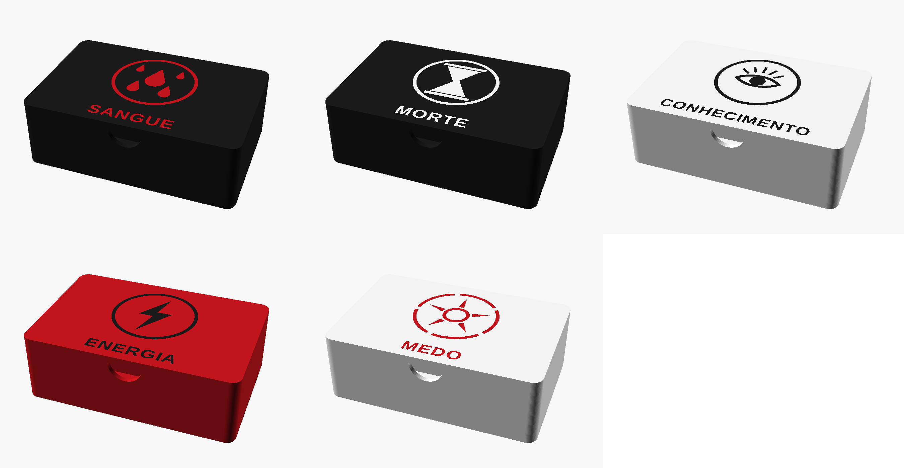

# Caixas de dados – elementos paranormais

Caixa para um jogo de 7 dados (interno 84 × 54 × 24 mm, externo 88 × 58 × 29 mm com tampa).
Emblemas **originais** inspirados em Sangue, Morte, Conhecimento, Energia e Medo – não são os símbolos oficiais de nenhum jogo.

## Arquivos (`saida/`)
| Arquivo | O que é | Como imprimir |
|---|---|---|
| `caixa.3mf` | base, igual para todas | PLA 0.2, sem suporte, abertura para cima |
| `<elemento>_tampa_2cores.3mf` | tampa + emblema como 2 objetos | atribua um filamento a cada objeto no Bambu Studio (AMS lite). Já vem virada: face de cima na mesa |
| `<elemento>_tampa_simples.3mf` | tampa de 1 cor, emblema gravado 0.8 mm | sem AMS; dá para pintar o rebaixo depois |

Cores sugeridas (caixa/emblema): Sangue preto/vermelho · Morte preto/branco · Conhecimento branco/preto · Energia vermelho/preto · Medo branco/vermelho.

Para mudar medidas: edite o topo de `caixa_elementos.scad` e rode `./build_caixas.sh`.

**Ainda não testado na impressora:** encaixe da tampa (folga 0.15 mm, não calibrada) e a tampa de 2 cores no Bambu Studio.
