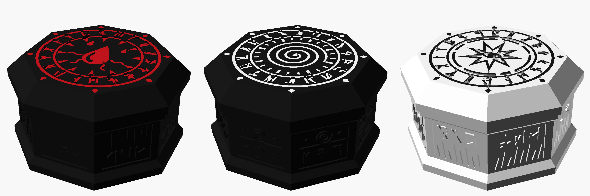

# Relicários – Morte, Sangue e Medo

Caixa octogonal decorativa que guarda um jogo de dados (cavidade 70 mm de face a face, ~26 mm úteis de altura).
Tampa com selo de duas cores (anel de runas, ornamentos e símbolo do elemento), oito painéis laterais em relevo,
base e moldura chanfradas. Fechado: 83 × 83 × ~46 mm.

| Arquivo (`saida/`) | Como imprimir |
|---|---|
| `<elemento>_corpo.3mf` | PLA 0.2 (ou 0.12 para relevo mais nítido), em pé, sem suporte |
| `<elemento>_tampa_2cores.3mf` | 2 objetos: atribua a cor do selo no Bambu Studio. Já vem virada (selo na mesa), sem suporte |
| `<elemento>_tampa_simples.3mf` | 1 cor, selo gravado 0.8 mm; dá para pintar depois |

Cores: Sangue preto + vermelho · Morte preto + branco · Medo branco + preto.
Acabamento opcional: pincel seco (drybrush) de vermelho nos escorridos do Sangue e cinza nas runas da Morte.

Símbolos oficiais (uso pessoal, não vender): veja `simbolos/LEIA.md`.
Para mudar algo: edite `relicario.scad` e rode `./build_relicarios.sh`.

**Ainda não testado na impressora:** encaixe da tampa (folga 0.15 mm) e a tampa de 2 cores no Bambu Studio.
